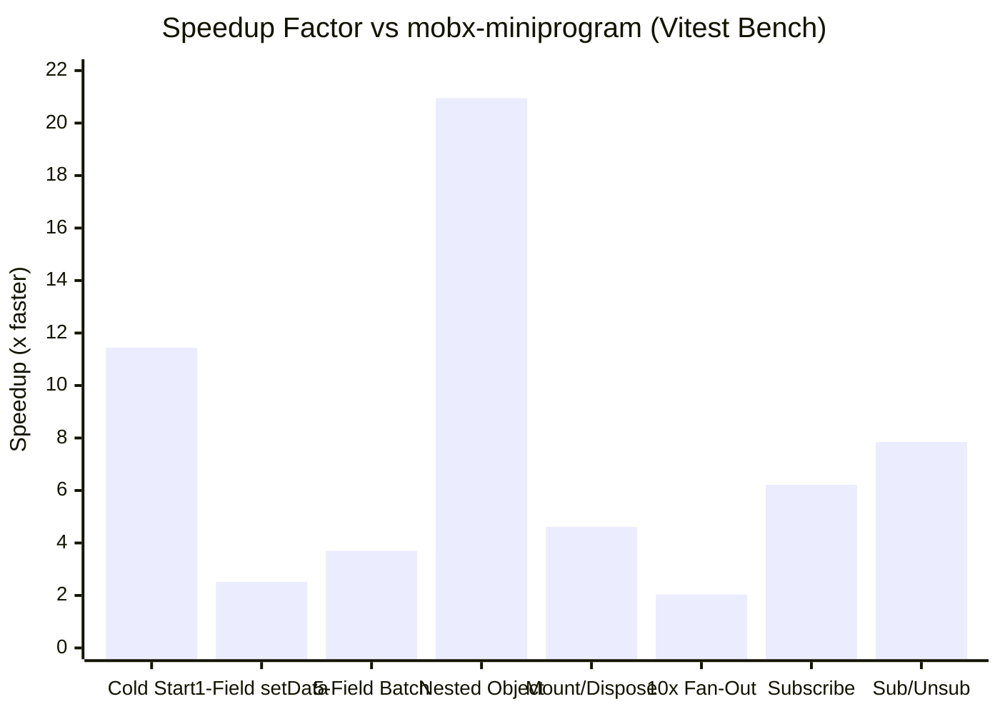
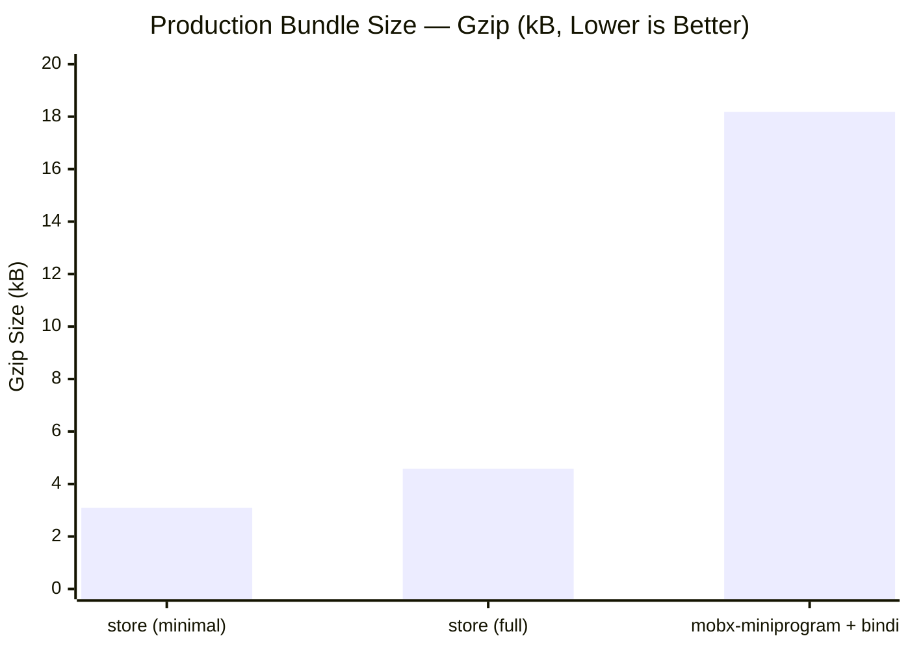

# `@code-id-labs/store`

Atomic state management for WeChat MiniPrograms built on [`alien-signals`](https://github.com/stackblitz/alien-signals).

## Installation

```bash
npm install @code-id-labs/store
# or
pnpm add @code-id-labs/store
```

If you are not using a bundler (`weapp-vite`, Webpack, etc.), run **Tools → Build npm** in WeChat DevTools after installing.

## Usage

### 1. Define Stores (`store/cart.ts`)

```ts
import {
  createStore,
  createPersistentStore,
  batch,
} from '@code-id-labs/store';

// Persistent stores (lazy-hydrated on first read, batched via wx.batchSetStorage,
// flushed on wx.nextTick and synced on wx.onAppHide)
export const themeStore = createPersistentStore<'light' | 'dark'>('app:theme', 'light');
export const discountStore = createPersistentStore('app:discount', 1.0);
export const noteStore = createPersistentStore('app:note', '', { debounceMs: 300 });

// Writable stores
export const cartCountStore = createStore(0);
export const unitPriceCentsStore = createStore(2990);
export const profileStore = createStore({
  name: 'Guest',
  stats: { points: 100 },
});

// Derived stores (read-only, lazy, cached)
export const totalCentsStore = createStore(() =>
  Math.round(cartCountStore.value * unitPriceCentsStore.value * discountStore.value)
);
export const formattedTotalStore = createStore(
  () => `¥${(totalCentsStore.value / 100).toFixed(2)}`
);

// Actions
export function increment() {
  cartCountStore.value++;
}

export function earnPoints(points: number) {
  const prev = profileStore.peek();
  // Immutable update -> diffSnapshot sends only `{ 'profile.stats.points': N }`
  profileStore.value = {
    ...prev,
    stats: { ...prev.stats, points: prev.stats.points + points },
  };
}

export function resetAll() {
  batch(() => {
    cartCountStore.reset();
    discountStore.reset();
    noteStore.clear();
  });
}
```

### 2. Bind to a Page (`pages/cart/index.ts`)

```ts
import { storeBehavior } from '@code-id-labs/store';
import {
  themeStore,
  cartCountStore,
  formattedTotalStore,
  profileStore,
  increment,
  earnPoints,
  resetAll,
} from '../../store/cart';

Page({
  behaviors: [storeBehavior],

  store: {
    theme: themeStore,
    cartCount: cartCountStore,
    formattedTotal: formattedTotalStore,
    profile: profileStore,
    increment,
    earnPoints,
    resetAll,
  },

  onIncrement() {
    this.store.increment();
  },

  onEarnPoints() {
    this.store.earnPoints(50);
  },

  onReset() {
    this.store.resetAll();
  },
});
```

### 3. Bind to a Component (`components/cart-badge/index.ts`)

```ts
import { storeBehavior } from '@code-id-labs/store';
import { cartCountStore } from '../../store/cart';

Component({
  behaviors: [storeBehavior],

  store: {
    count: cartCountStore,
  },

  methods: {
    onTap() {
      if (this.store.count.peek() === 0) return;
      wx.navigateTo({ url: '/pages/checkout/index' });
    },
  },
});
```

### 4. Subscribe Outside Pages / Components

```ts
const unsubscribe = cartCountStore.subscribe((value, prevValue) => {
  console.log(`${prevValue} -> ${value}`);
});

unsubscribe();
```

`subscribe` also supports `{ immediate: true }` and `const { unsubscribe } = store.subscribe(...)`.

## API

| Export | Description |
| :--- | :--- |
| `createStore(initialValue)` | Writable store with `.value`, `.peek()`, `.reset()`, `.subscribe()`. |
| `createStore((prev?) => value)` | Derived read-only store with `.value`, `.peek()`, `.subscribe()`. |
| `createPersistentStore(key, defaultValue, opts?)` | Persistent store backed by WeChat storage (`debounceMs`, `onError`), plus `.clear()`. |
| `batch(fn)` | Coalesces multiple mutations into a single update / `setData` flush. |
| `storeBehavior` / `createStoreBehavior(opts?)` | `definitionFilter` Behavior enabling `store: { ... }` and `this.store` on `Page` & `Component`. |
| `bindStoreBehavior(bindings, opts?)` | Explicit stackable Behavior with typed `this.store` and `this.data`. |
| `bindStore(instance, bindings, opts?)` | Low-level binding returning `{ pause, resume, dispose }`. |
| `diffSnapshot(prev, next, path, out)` | Diffs objects/arrays into WeChat dot/bracket `setData` paths. |
| `isStore(value)` | Type guard distinguishing reactive stores from action functions. |

## Benchmarks

Measured against `mobx-miniprogram@6.12.3` + `mobx-miniprogram-bindings@4.0.1` using Vitest Bench (`pnpm bench`) and esbuild production bundling (`pnpm compare:size`) on Node 24.

### Speedup vs `mobx-miniprogram` (Higher is Better)



| Scenario | `@code-id-labs/store` (ops/s) | `mobx-miniprogram` (ops/s) | Speedup |
| :--- | ---: | ---: | ---: |
| Cold-start creation (50 fields + 10 derived) | 321,250 | 28,614 | 11.44× |
| Single primitive update → `setData` (20 bound fields) | 3,036,409 | 1,204,671 | 2.52× |
| Batched 5-field update + derived → `setData` | 1,015,839 | 292,566 | 3.70× |
| Nested object leaf mutation → `setData` | 1,218,580 | 59,184 | 20.95× |
| Page lifecycle churn (mount + dispose 10 fields) | 528,987 | 114,681 | 4.61× |
| Multi-component fan-out (10 subscribers) | 296,119 | 145,334 | 2.04× |
| Direct subscribe + notify (`subscribe` vs `reaction`) | 13,037,847 | 2,097,373 | 6.22× |
| Subscribe + unsubscribe churn | 10,558,347 | 1,344,257 | 7.85× |

### Bundle Size (Minified + Bundled Dependencies)



| Package | Minified | Gzip (lv9) | Brotli |
| :--- | ---: | ---: | ---: |
| `@code-id-labs/store` (minimal: `createStore` + `batch` + `bindStore`) | 8.30 kB | 3.09 kB | 2.86 kB |
| `@code-id-labs/store` (full) | 13.15 kB | 4.58 kB | 4.22 kB |
| `mobx-miniprogram` + `mobx-miniprogram-bindings` | 57.97 kB | 18.18 kB | 16.18 kB |

### `setData` Payload Size

| Scenario | `@code-id-labs/store` | `mobx-miniprogram` | Reduction |
| :--- | :--- | ---: | ---: |
| Nested object leaf (`profile.stats.points`) | 29 B (`{"profile.stats.points":1001}`) | 337 B | 91.4% |
| Array item leaf (`cart[0].qty`) | 17 B (`{"cart[0].qty":2}`) | 371 B | 95.4% |

## Development

```bash
pnpm install
pnpm build
pnpm typecheck
pnpm test
pnpm bench
pnpm compare:size
```
